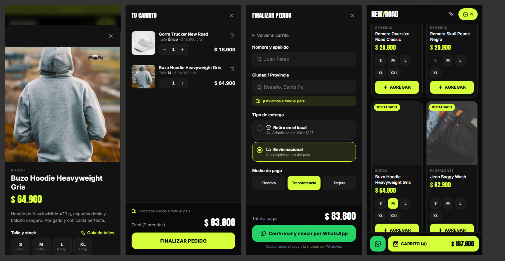
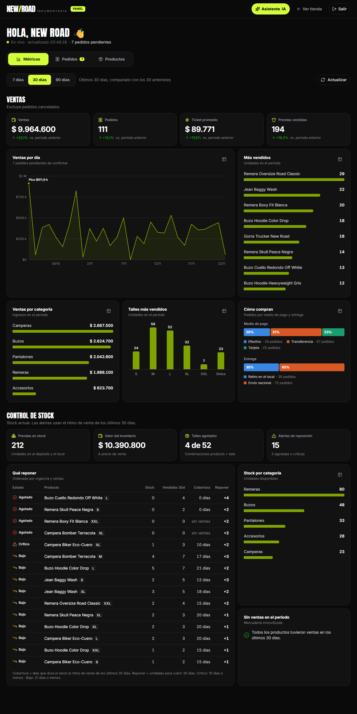
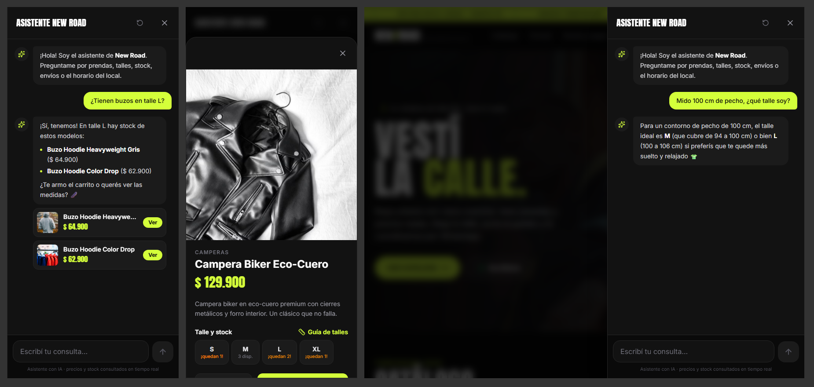
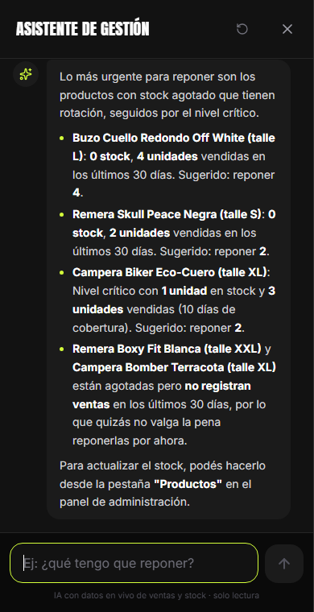
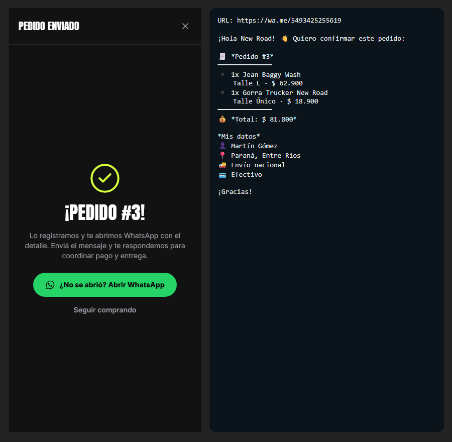
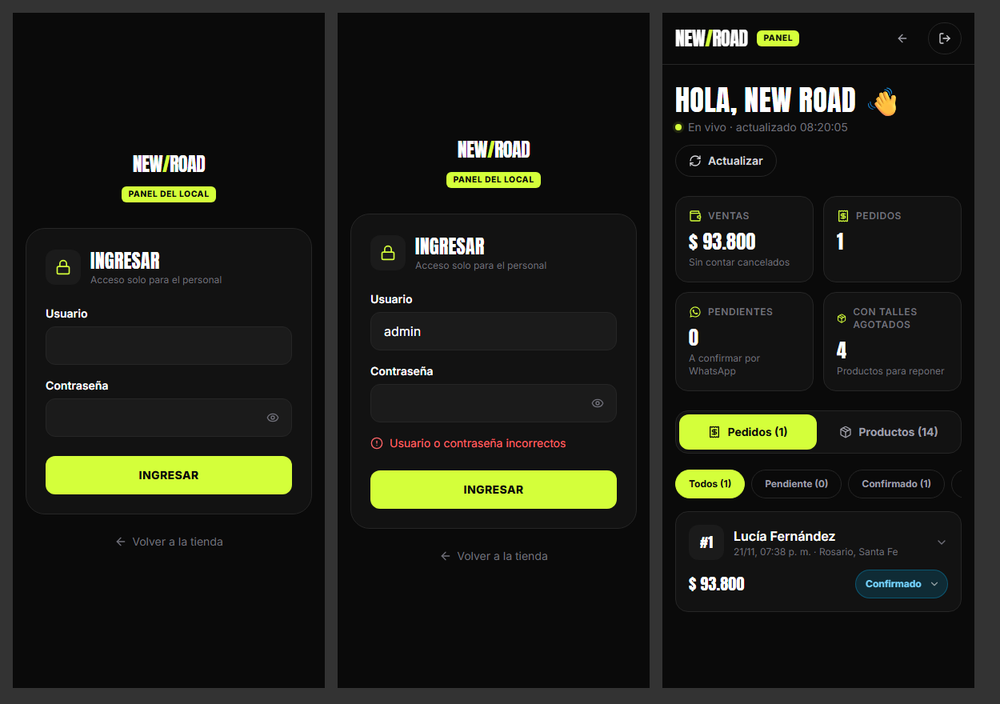

# New Road Indumentaria — Tienda online con checkout por WhatsApp

Demo funcional de e-commerce para **New Road Indumentaria**, local de ropa urbana en
Av. Aristóbulo del Valle 6127, Santa Fe Capital (Argentina).

Pensada **mobile-first**, porque la mayoría de los clientes llega desde Instagram: el cliente arma el
carrito, completa un formulario corto y el pedido se guarda en la base y se abre en WhatsApp con el
detalle listo para enviar. Incluye un **asistente con IA** que responde con precios y stock en tiempo
real y un **panel de administración** con login.

<p align="center">
  
</p>

---

## Índice

- [Funcionalidades](#funcionalidades)
- [Stack](#stack)
- [Requisitos](#requisitos)
- [Instalación](#instalación)
- [Uso en desarrollo](#uso-en-desarrollo)
- [Estructura del proyecto](#estructura-del-proyecto)
- [Base de datos](#base-de-datos)
- [API REST](#api-rest)
- [Asistente con IA](#asistente-con-ia)
- [Seguridad del panel admin](#seguridad-del-panel-admin)
- [Personalización](#personalización)
- [Producción](#producción)
- [Capturas](#capturas)

---

## Funcionalidades

### Tienda (`/`)
- **Catálogo** con buscador (ignora tildes), filtros por **categoría** (Remeras, Buzos, Pantalones,
  Camperas, Accesorios) y por **talle con stock** (S a XXL), con resultados instantáneos.
- **Tarjetas de producto** con foto, precio en ARS, selector de talle (los agotados aparecen tachados) y
  botón "Agregar al carrito". Etiquetas automáticas: *Destacado*, *Últimas unidades*, *Agotado*.
- **Detalle de producto** con descripción, stock por talle ("¡quedan 2!"), cantidad y acceso a la guía de talles.
- **Guía de talles interactiva**: tablas en cm para remeras, buzos/camperas y pantalones (con
  equivalencia al talle numérico argentino), más una calculadora de *"¿Qué talle soy?"*.
- **Carrito lateral** con sumar/restar (respeta el stock), eliminar y total. Se guarda en el navegador.
- **Checkout por WhatsApp**: nombre, ciudad/provincia, tipo de entrega (retiro / envío nacional) y medio
  de pago (efectivo / transferencia / tarjeta). Al confirmar:
  1. guarda el pedido en MySQL y **descuenta el stock** en una transacción, con precios tomados de la
     base y no del navegador;
  2. abre `wa.me/5493425255619` con un mensaje prolijo con el número de pedido, las prendas, los talles,
     el total y los datos del cliente.
- **Sección del local**: mapa de Google Maps, horarios con indicador *Abierto / Cerrado ahora* según la
  hora de Argentina, botón "Cómo llegar" y bloques de *Envíos a todo el país* y *Todos los medios de pago*.
- **Asistente con IA** (ver [más abajo](#asistente-con-ia)).

### Panel admin (`/admin`)
- **Login** con usuario y contraseña.
- **Métricas** con filtro de período (7 / 30 / 90 días), todas con tooltip y vista de tabla:
  - KPIs de ventas, pedidos, ticket promedio y prendas vendidas, con **variación contra el período anterior**.
  - **Ventas por día** (línea con cursor que encuentra el día y navegación con teclado).
  - **Más vendidos**, **ventas por categoría**, **talles más vendidos** y **cómo compran** (medio de pago y entrega).
- **Control de stock**:
  - Prendas en stock, valor del inventario a precio de venta y talles agotados.
  - **Qué reponer**: alertas por producto y talle (*Agotado / Crítico / Bajo*) según el ritmo de venta de
    los últimos 30 días, con **días de cobertura** y **cantidad sugerida a reponer**.
  - Stock por categoría y productos **sin ventas** en el período (mercadería inmovilizada).
- **Asistente de gestión con IA** (solo lectura): "¿cómo vienen las ventas este mes?", "¿qué tengo que
  reponer?", "¿qué pedidos tengo pendientes?". Responde con los datos en vivo y nunca modifica nada.
- **Pedidos** con actualización automática cada 8 segundos: filtro por estado, detalle de ítems y cambio de
  estado (*pendiente → confirmado → enviado → entregado*). Si un pedido se **cancela, el stock se repone**.
- **Productos**: edición en línea de precio y stock por talle, ocultar/mostrar en la tienda y alta de
  productos nuevos con vista previa de la foto y **descripción generada con IA**.

<p align="center">
  
</p>

---

## Stack

| Capa | Tecnología |
| --- | --- |
| Frontend | React 19, Vite, Tailwind CSS v4, React Router, Lucide |
| Backend | Node.js, Express 5, `mysql2/promise`, `cors`, `dotenv` |
| Base de datos | MySQL 8 |
| IA | Google Gemini (API REST) con Function Calling |

El backend no usa dependencias extra para la autenticación ni para la IA: usa `node:crypto` y `fetch` nativos.

---

## Requisitos

- **Node.js 18 o superior** (probado con Node 22)
- **MySQL 8** corriendo localmente
- *(Opcional)* una **API key de Gemini** para el asistente — https://aistudio.google.com/apikey.
  Sin key la tienda funciona igual: el asistente simplemente no aparece.

---

## Instalación

```bash
git clone <url-del-repo>
cd newroadsf-demo

# 1. Dependencias
cd backend && npm install
cd ../frontend && npm install
cd ..

# 2. Variables de entorno del backend
cp backend/.env.example backend/.env
#    -> completar DB_PASSWORD (y GEMINI_API_KEY si querés el asistente)

# 3. Base de datos + datos de ejemplo (14 productos y ~300 pedidos de los últimos 90 días)
cd backend
npm run db:init

# 4. Usuario del panel admin
npm run admin:crear -- admin <tu-contraseña>
```

> `npm run db:init` **borra y recrea** la base `newroad_db`. También sirve para dejar la demo como nueva.

---

## Uso en desarrollo

Dos terminales:

```bash
# Terminal 1 — API en http://localhost:3001/api
cd backend
npm run dev

# Terminal 2 — Tienda en http://localhost:5173
cd frontend
npm run dev
```

| Qué | URL |
| --- | --- |
| Tienda | http://localhost:5173 |
| Panel admin | http://localhost:5173/admin |
| Healthcheck de la API | http://localhost:3001/api/health |

En desarrollo, Vite redirige `/api` al backend, así que no hace falta configurar CORS.

### Scripts

| Carpeta | Comando | Qué hace |
| --- | --- | --- |
| `backend` | `npm run dev` | API con recarga automática |
| `backend` | `npm start` | API sin recarga (producción) |
| `backend` | `npm run db:init` | Recrea la base, carga el catálogo y genera el historial de ventas de demo |
| `backend` | `npm run admin:crear -- <usuario> [contraseña]` | Crea o cambia el usuario del panel (sin contraseña, genera una segura) |
| `frontend` | `npm run dev` | Servidor de desarrollo |
| `frontend` | `npm run build` | Build de producción en `frontend/dist` |

---

## Estructura del proyecto

```
newroadsf-demo/
├── backend/
│   ├── schema.sql              # Base, tablas y catálogo inicial
│   ├── .env.example            # Variables de entorno (copiar a .env)
│   ├── scripts/
│   │   ├── init-db.js          # Ejecuta schema.sql + genera el historial de ventas
│   │   ├── seed-ventas.js      # Historial de 90 días (determinístico) para las métricas
│   │   └── crear-admin.js      # Usuario/contraseña del panel
│   └── src/
│       ├── server.js           # App Express y manejo de errores
│       ├── db.js               # Pool MySQL + helper de transacciones
│       ├── auth.js             # Hash scrypt, sesión firmada, middleware
│       ├── metricas.js         # Ventas, rankings, inventario y alertas de reposición
│       ├── routes/             # productos, pedidos, auth, chat, metricas, adminIA
│       └── chat/               # Cliente Gemini + prompts y herramientas (tienda y admin)
├── frontend/
│   ├── public/favicon.png
│   └── src/
│       ├── pages/              # Store (tienda) y Admin (panel + login)
│       ├── components/         # Tarjetas, modales, carrito, chat, etc.
│       │   ├── admin/          # Panel de métricas y control de stock
│       │   └── charts/         # Gráficos propios en SVG/HTML (sin librerías)
│       ├── context/            # Estado del carrito
│       └── lib/                # API, formato ARS, WhatsApp, datos del local, guía de talles
└── docs/capturas/
```

---

## Base de datos

Definida en [`backend/schema.sql`](backend/schema.sql):

| Tabla | Contenido |
| --- | --- |
| `productos` | Nombre, categoría, descripción, precio, foto, destacado, activo |
| `producto_talles` | Stock por producto y talle (`S`, `M`, `L`, `XL`, `XXL`, `U` = único) |
| `pedidos` | Cliente, localidad, tipo de entrega, medio de pago, total y estado |
| `pedido_items` | Prendas de cada pedido, con nombre y precio *congelados* al momento de la compra |

Los productos se dan de baja de forma lógica (`activo = 0`), así el historial de pedidos se conserva.

---

## API REST

Base: `http://localhost:3001/api` · 🔒 = requiere sesión de admin

| Método | Ruta | Descripción |
| --- | --- | --- |
| `GET` | `/health` | Estado de la API y de MySQL |
| `GET` | `/productos?q=&categoria=&talle=` | Catálogo con talles y stock |
| `GET` | `/productos?todos=1` 🔒 | Incluye los productos ocultos |
| `GET` | `/productos/:id` | Detalle de un producto |
| `GET` | `/productos/:id/talles` | Stock por talle |
| `POST` | `/productos` 🔒 | Alta de producto (con `talles: [{ talle, stock }]`) |
| `PATCH` | `/productos/:id` 🔒 | Edición parcial (precio, nombre, activo…) |
| `PUT` | `/productos/:id/talles` 🔒 | Actualiza el stock por talle |
| `DELETE` | `/productos/:id` 🔒 | Baja lógica |
| `POST` | `/pedidos` | Crea un pedido (checkout). Valida stock y descuenta |
| `GET` | `/pedidos` 🔒 | Pedidos con sus ítems |
| `GET` | `/pedidos/:id` 🔒 | Detalle de un pedido |
| `PATCH` | `/pedidos/:id/estado` 🔒 | Cambia el estado. Si se cancela, repone el stock |
| `POST` | `/auth/login` | Inicia sesión (`{ usuario, password }`) |
| `POST` | `/auth/logout` | Cierra la sesión |
| `GET` | `/auth/me` | Devuelve la sesión actual |
| `GET` | `/chat/estado` | Indica si el asistente de la tienda está disponible |
| `POST` | `/chat` | Conversa con el asistente de la tienda (`{ mensajes: [{ rol, texto }] }`) |
| `GET` | `/metricas?dias=30` 🔒 | Tablero completo: ventas, rankings, distribución, inventario y alertas |
| `GET` | `/admin/ia/estado` 🔒 | Indica si la IA del panel está disponible |
| `POST` | `/admin/ia/chat` 🔒 | Conversa con el asistente de gestión (solo lectura) |
| `POST` | `/admin/ia/descripcion` 🔒 | Genera la descripción de un producto (`{ nombre, categoria, detalles? }`) |

Los errores devuelven JSON con un mensaje legible: `{ "error": "Sin stock suficiente — …" }`.

---

## Asistente con IA

<p align="center">
  
</p>

Diseño simple, sin base vectorial: **Gemini + System Prompt + Function Calling contra MySQL**.

- **Información fija** (dirección, horarios, envíos, medios de pago y guía de talles): va en el System
  Prompt ([`backend/src/chat/prompt.js`](backend/src/chat/prompt.js)) y se lee de los **mismos archivos
  que usa la web**, así hay una sola fuente de verdad. El estado "abierto/cerrado" lo calcula el servidor:
  el modelo no hace cuentas con horarios.
- **Catálogo en vivo**: el modelo llama a `buscar_productos` y `ver_producto`
  ([`backend/src/chat/tools.js`](backend/src/chat/tools.js)), que son consultas **de solo lectura** a
  MySQL. Precios y stock siempre están actualizados, y si algo no existe devuelve alternativas reales.
- **En la web**, los productos que nombra se muestran como tarjetas con botón "Ver".
- **Robustez**: cadena de modelos de respaldo, timeouts, límite de 15 mensajes por minuto por IP y, si
  todo falla, deriva a WhatsApp.

```env
GEMINI_API_KEY=...
GEMINI_MODELS=gemini-3.5-flash-lite,gemini-3.5-flash,gemini-3.1-flash-lite
```

**Costo de referencia** (medido con `gemini-3.5-flash-lite`): unos US$ 0,0015 por consulta que usa el
catálogo. Mil conversaciones de 5 mensajes por mes rondan los US$ 7–10.

### Asistente de gestión (panel admin)

<p align="center">
  
</p>

Mismo cliente de Gemini, con su propio prompt y **herramientas de solo lectura** sobre ventas y stock
([`backend/src/chat/adminTools.js`](backend/src/chat/adminTools.js)): resumen de ventas con comparación,
ventas por día, más vendidos, categorías y talles, medios de pago, estado del stock con alertas de
reposición, y búsqueda de pedidos. Usa **el mismo módulo de métricas que los gráficos**
([`backend/src/metricas.js`](backend/src/metricas.js)), así los números del chat y del tablero siempre coinciden.

- No puede cambiar precios, stock ni pedidos: si se lo piden, indica dónde hacerlo en el panel.
- Al recomendar reposición, justifica con unidades vendidas, stock actual y días de cobertura.
- Tiene un margen de espera mayor que el chat de la tienda (45 s) para tolerar picos de demanda de la API.
- Uso estimado: 20 consultas por día ≈ US$ 1–2 por mes.

En **Productos → Agregar producto nuevo**, el botón **"Generar con IA"** redacta la descripción a partir
del nombre, la categoría y las notas que haya escritas.

---

## Seguridad del panel admin

- La contraseña se guarda como **hash `scrypt`** en `backend/.env`, nunca en texto plano.
- La sesión es un token **firmado con HMAC** dentro de una cookie **`HttpOnly`** + **`SameSite=Strict`**
  que dura 8 horas.
- Tras **5 intentos fallidos**, el login se bloquea 15 minutos para esa IP.
- Si la sesión vence mientras se usa el panel, vuelve automáticamente a la pantalla de login.

Para cambiar el usuario o la contraseña:

```bash
cd backend
npm run admin:crear -- <usuario> <contraseña>   # luego reiniciar el backend
```

> ⚠️ Usá una contraseña fuerte antes de publicar el sitio. Sin argumento de contraseña, el script genera una segura.

---

## Personalización

| Qué | Dónde |
| --- | --- |
| Nombre, dirección, WhatsApp, Instagram y horarios | [`frontend/src/lib/constants.js`](frontend/src/lib/constants.js) |
| Medidas de la guía de talles | [`frontend/src/lib/sizeGuide.js`](frontend/src/lib/sizeGuide.js) |
| Colores y tipografías | [`frontend/src/index.css`](frontend/src/index.css) (bloque `@theme`) |
| Mensaje de WhatsApp del pedido | [`frontend/src/lib/whatsapp.js`](frontend/src/lib/whatsapp.js) |
| Personalidad y reglas del asistente de la tienda | [`backend/src/chat/prompt.js`](backend/src/chat/prompt.js) |
| Reglas del asistente de gestión y estilo de las descripciones | [`backend/src/chat/adminPrompt.js`](backend/src/chat/adminPrompt.js) |
| Umbrales de las alertas de stock (crítico / bajo / días a cubrir) | [`backend/src/metricas.js`](backend/src/metricas.js) |
| Colores de los gráficos (validados para daltonismo) | [`frontend/src/index.css`](frontend/src/index.css) (bloque `@theme static`) |
| Catálogo inicial | [`backend/schema.sql`](backend/schema.sql) o desde el panel admin |

Los cambios en `constants.js` y `sizeGuide.js` impactan **tanto en la web como en el asistente**.

---

## Producción

Checklist antes de publicar:

- [ ] Servir con **HTTPS** y definir `NODE_ENV=production`, que activa la cookie `Secure`.
- [ ] Usar una **contraseña fuerte** para el panel (`npm run admin:crear`).
- [ ] Usar una **API key de Gemini propia del cliente**, en el plan pago, para separar costos y proteger
      los datos del negocio.
- [ ] Si el frontend y la API están en dominios distintos: definir `VITE_API_URL` en el build y
      configurar CORS con `credentials` para el dominio del frontend.
- [ ] Reemplazar las fotos de Unsplash por fotos propias del local.
- [ ] Cargar el catálogo y los precios reales, **sin** el historial de ventas de demo: correr solo
      `schema.sql` (por ejemplo `mysql -u root -p < backend/schema.sql`) en lugar de `npm run db:init`.
- [ ] Configurar la zona horaria de MySQL en Argentina (`America/Argentina/Cordoba`): las métricas agrupan
      las ventas por día según la hora del servidor.

---

## Capturas

| Pedido → WhatsApp | Panel admin |
| --- | --- |
|  |  |

---

<sub>Las fotos de producto son imágenes de prueba de [Unsplash](https://unsplash.com). Demo desarrollada como propuesta comercial.</sub>
